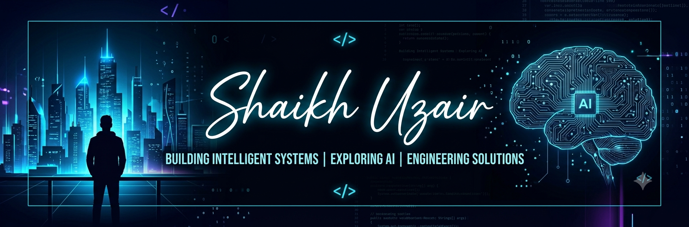

<div align="center">



<br/>

<a href="https://git.io/typing-svg">
  
</a>

<br/>

<a href="https://github.com/ShaikhUzair7777">
  
</a>

</div>

---

## 👨‍💻 About Me

```yaml
name: Shaikh Uzair
education: B.Tech Information Technology
university: MGM University, IICT
graduation: 2027
interests:
  - Artificial Intelligence
  - Software Development
  - Full-Stack Development
  - Database Engineering
currently:
  - Building practical software projects
  - Exploring AI-powered applications
  - Improving problem-solving and engineering skills
```

- 🎓 Final-year B.Tech IT student at MGM University.
- 🤖 Interested in building intelligent, AI-powered applications.
- 🛠️ Learning by building real-world projects.
- 🚀 Passionate about turning ideas into practical solutions.
- ⚽ Football enthusiast and creative video editor.

---

<h2 align="center">⚡ Tech Stack & Tools</h2>

<h3 align="center">💻 Programming Languages</h3>

<p align="center">
  
</p>

<h3 align="center">🚀 Frameworks & Development</h3>

<p align="center">
  
</p>

<h3 align="center">🗄️ Databases & Backend</h3>

<p align="center">
  
</p>

<h3 align="center">🛠️ Tools & Platforms</h3>

<p align="center">
  
</p>

---

## 🚀 Featured Projects

<table>
<tr>
<td width="50%">

### 🧠 AI UX Accessibility Laboratory

AI-powered website accessibility testing and UX simulation.

**Tech:** Python, FastAPI, Playwright, axe-core

<a href="https://github.com/ShaikhUzair7777/AI-Powered-Multi-Persona-UX-Accessibility-Evaluation-Laboratory">View Repository →</a>

</td>
<td width="50%">

### ⚽ GetMySlot

A turf booking platform designed to make sports ground reservations easier.

**Concept:** Booking a turf as simple as booking a movie ticket.

<a href="https://play.google.com/store/apps/details?id=com.getmyslot.app">View on Play Store →</a>

</td>
</tr>

<tr>
<td width="50%">

### 🏥 Hospital Management SQL System

Relational database project demonstrating SQL queries, database design and management.

**Tech:** MySQL, SQL

<a href="https://github.com/ShaikhUzair7777/Hospital-Management-SQL-System">View Repository →</a>

</td>
<td width="50%">

### 🎯 QuizMaster

Interactive quiz application with authentication and quiz management.

**Tech:** Java, JSP, Servlets, Maven, Supabase

<a href="https://github.com/ShaikhUzair7777/QuizMaster">View Repository →</a>

</td>
</tr>

<tr>
<td width="50%">

### 🌦️ Weather Dashboard

Weather dashboard with chatbot functionality and dynamic weather information.

**Tech:** JavaScript, HTML, CSS

<a href="https://github.com/ShaikhUzair7777/weather-dashboard-chatbot">View Repository →</a>

</td>
<td width="50%">

### 📚 AI Personalized Learning Recommendation

A project exploring personalized learning recommendations using AI.

**Tech:** Python

<a href="https://github.com/ShaikhUzair7777/ai-personalized-learning-recommendation">View Repository →</a>

</td>
</tr>
</table>

---


<h2 align="center">📊 GitHub Statistics</h2>

<div align="center">


</div>


## 🐍 GitHub Contribution Snake

<p align="center">
  
</p>

## 🌐 Connect With Me

<div align="center">

<a href="https://github.com/ShaikhUzair7777">

</a>

<a href="https://www.linkedin.com/in/shaikh-uzair-353860651">

</a>

<a href="mailto:skuzair321@gmail.com">

</a>

</div>

---

<div align="center">

### 💡 "Building today. Innovating tomorrow."


</div>
